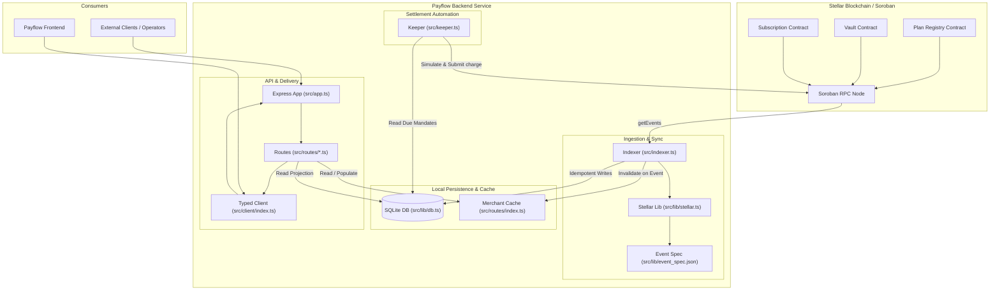

# Payflow Backend Architecture

This document provides an architectural overview of the Payflow backend service, detailing how the event indexer, settlement keeper, SQLite projection database, and REST API interact.

---

## 1. System Overview

Soroban smart contracts on Stellar manage subscription plans, recurring payment mandates, and token custody in vaults. While the contracts handle transaction execution and invariant validation, on-chain state cannot efficiently serve aggregate queries such as "list all active mandates for a merchant sorted by revenue" or "compute Monthly Recurring Revenue (MRR)".

The Payflow backend bridges this gap by:
1. **Indexing**: Ingesting contract events via Soroban RPC, validating them against committed contract specifications, and projecting them idempotently into a local SQLite database.
2. **Keeper Automation**: Inspecting due mandates and submitting permissionless `charge` transactions to Stellar to execute recurring billing.
3. **Serving**: Providing a low-latency, typed HTTP REST API consumed by `payflow-frontend` and external integrations.

---

## 2. Component Architecture Diagram

---

## 3. Walkthrough: From On-Chain Charge to REST API

Here is the exact end-to-end lifecycle of a recurring payment charge:

1. **Triggering Settlement**:
   - The **Keeper** (`src/keeper.ts`), running on a scheduled interval via `src/lib/loop.ts` (or standalone from `src/cmd/keeper.ts` or GitHub Actions), queries SQLite (`src/lib/db.ts`) for active mandates where `next_charge <= now`.
   - The keeper constructs a `charge` invocation targeting the Subscription Contract (`SUBSCRIPTION_ID`).
   - The keeper calls `prepareTransaction` on the Soroban RPC (`src/lib/stellar.ts`) to simulate transaction footprint and resources.
   - The keeper signs the transaction with `KEEPER_SECRET` (or `KEEPER_SECRET_NEXT` during key rotation) and submits it to the network.

2. **On-Chain Execution**:
   - The Subscription Contract validates the mandate, moves funds via the Vault Contract, calculates protocol fees, updates on-chain state, and emits a `charged` contract event containing:
     - Topics: `["charged", mandate_id, subscriber, merchant]`
     - Data: `{ amount, fee, charges_made, next_charge }`

3. **Event Ingestion & Validation**:
   - The **Indexer** (`src/indexer.ts`) periodically polls Soroban RPC using `getEvents` for ledger ranges `[cursor, cursor + 8000)`.
   - Raw RPC events are decoded using helper utilities in `src/lib/stellar.ts`.
   - Decoded events are validated against the schema defined in `src/lib/event_spec.json`. If an event shape differs (e.g., mismatched types or missing attributes), it is rejected, logged with warnings (`src/lib/logger.ts`), and incremented in `mismatchedEvents` to guard projection integrity.

4. **Projection into SQLite & Cache Invalidation**:
   - Upon successful validation, the indexer routes the event to `onCharged()`.
   - SQLite table `charges` records the transaction via an idempotent `INSERT OR IGNORE` keyed on `(tx_hash, mandate_id)`.
   - SQLite table `mandates` updates `charges_made`, `next_charge`, and calculates `last_charge` (`MAX(0, next_charge - period)`), guarded by `WHERE charges_made < ?` to prevent out-of-order ledger updates.
   - SQLite table `mandate_events` records each mandate lifecycle event (started, cancelled, ended, completed) with the ledger's close time, via an idempotent `INSERT OR IGNORE` keyed on `(mandate_id, slot)` where `slot` is `start` or `departure`. This log is what the merchant churn report reads.
   - The indexer immediately invalidates the in-memory cache for `merchant` in `MerchantSummaryCache` (`src/routes/merchants.ts`, exported in `src/routes/index.ts`).
   - The ledger cursor is saved to SQLite `meta` via `writeCursor()` in `src/lib/db.ts`.

5. **Data Freshness Tracking**:
   - As the indexer advances, it tracks the close time of indexed ledgers (from `raw.ledgerClosedAt` or `getLatestLedger().closeTime`).
   - `freshnessSeconds` is updated to reflect the elapsed seconds between the current time and the last indexed ledger close time.

6. **Serving via REST API & Typed Client**:
   - When a user loads the merchant dashboard, the frontend requests `GET /api/merchants/:address/summary`.
   - The request passes through Express middleware in `src/app.ts` (assigning `X-Request-Id`, recording OpenTelemetry spans via `src/lib/telemetry.ts`, logging with `src/lib/logger.ts`).
   - `merchantsRouter` (`src/routes/merchants.ts`) checks `MerchantSummaryCache`. If cached, it returns immediately; otherwise, it computes MRR, ARR, and total collected from SQLite, stores it in the LRU cache, and returns the response.
   - The response conforms to the typed definitions in `src/routes/types.ts` and is consumed via `PayflowClient` in `src/client/index.ts`.

---

## 4. Codebase Directory Map (Files in `src/`)

Every source file in `src/` fulfills a distinct, decoupled responsibility:

### Core Application & Entry Points
- [`src/index.ts`](file:///home/ademola/drips_wave_workspace/kd-payflow-backend/src/index.ts): Main process entry point. Loads configuration, initializes telemetry, connects to the SQLite database, starts the indexer and keeper loops via `every()`, starts the Express HTTP server, handles `SIGHUP` for zero-downtime key rotation, and coordinates graceful shutdown.
- [`src/config.ts`](file:///home/ademola/drips_wave_workspace/kd-payflow-backend/src/config.ts): Environment configuration parsing and validation using Zod. Validates contract addresses, RPC endpoints, secret keys, polling intervals, and CORS origins.
- [`src/app.ts`](file:///home/ademola/drips_wave_workspace/kd-payflow-backend/src/app.ts): Express application factory (`createApp`). Configures CORS, JSON request body limits, Pino HTTP request logging, OpenTelemetry tracing spans, standard error handlers, and the `/health` endpoint reporting operational status, lag, data freshness in seconds, and contract wiring.
- [`src/indexer.ts`](file:///home/ademola/drips_wave_workspace/kd-payflow-backend/src/indexer.ts): Event indexer engine (`Indexer`). Fetches ledger event windows concurrently, decodes and validates contract events, applies idempotent database projections, updates data freshness, and invalidates merchant summary caches.
- [`src/keeper.ts`](file:///home/ademola/drips_wave_workspace/kd-payflow-backend/src/keeper.ts): Autonomous settlement keeper (`Keeper`). Identifies due mandates from SQLite, manages exponential backoff for underfunded accounts, prepares transactions via Soroban RPC simulation, signs transactions, handles standby key rotation, and submits charges.

### Command-Line Executables
- [`src/cmd/indexer.ts`](file:///home/ademola/drips_wave_workspace/kd-payflow-backend/src/cmd/indexer.ts): CLI script to execute indexer catch-up passes until fully synchronized with the RPC latest ledger, then exits cleanly (useful for cron jobs, migrations, and backfills).
- [`src/cmd/keeper.ts`](file:///home/ademola/drips_wave_workspace/kd-payflow-backend/src/cmd/keeper.ts): CLI script to run a single settlement pass for all currently due mandates and exit (used in periodic runners like GitHub Actions keeper).

### Shared Libraries (`src/lib/`)
- [`src/lib/db.ts`](file:///home/ademola/drips_wave_workspace/kd-payflow-backend/src/lib/db.ts): SQLite database connection layer using Node.js built-in `node:sqlite`. Creates tables (`plans`, `mandates`, `charges`, `vault_events`, `meta`, `mandate_events`), runs schema migrations, and provides cursor read/write helpers. `DatabasePool` bounds the connections a database file may have open (`DATABASE_MAX_CONNS`, `DATABASE_MIN_CONNS`): the API reads through the shared connection, the long passes (indexer, reconciler, keeper) each take one of their own.
- [`src/lib/churn.ts`](file:///home/ademola/drips_wave_workspace/kd-payflow-backend/src/lib/churn.ts): Churn bucket arithmetic for the merchant churn report — the calendar (`day`, `week`, `month`) bucket a mandate event falls in, expressed once in TypeScript and once as the equivalent SQL expression so the aggregation can run inside SQLite.
- [`src/lib/loop.ts`](file:///home/ademola/drips_wave_workspace/kd-payflow-backend/src/lib/loop.ts): Asynchronous task scheduler (`every`). Guarantees that interval passes never overlap, even when backfills or RPC calls take longer than the scheduled period, and supports graceful drainage upon shutdown.
- [`src/lib/stellar.ts`](file:///home/ademola/drips_wave_workspace/kd-payflow-backend/src/lib/stellar.ts): Soroban RPC integration helpers, ScVal parsers (`str`, `num`, `big`), transaction builders, and contract event decoding and specification compliance verification.
- [`src/lib/telemetry.ts`](file:///home/ademola/drips_wave_workspace/kd-payflow-backend/src/lib/telemetry.ts): OpenTelemetry distributed tracing helpers (`initTelemetry`, `withSpan`) that trace RPC interactions, indexer batches, keeper passes, and incoming HTTP requests.
- [`src/lib/logger.ts`](file:///home/ademola/drips_wave_workspace/kd-payflow-backend/src/lib/logger.ts): Pino structured logger configuration with automatic redaction of sensitive credentials (such as `KEEPER_SECRET` and `KEEPER_SECRET_NEXT`).
- [`src/lib/event_spec.json`](file:///home/ademola/drips_wave_workspace/kd-payflow-backend/src/lib/event_spec.json): Machine-readable contract event specification defining expected event topics, signatures, and data fields for `plan_created`, `plan_status_changed`, `subscribed`, `charged`, `cancelled`, and vault events.

### API Routes & Client (`src/routes/` and `src/client/`)
- [`src/routes/index.ts`](file:///home/ademola/drips_wave_workspace/kd-payflow-backend/src/routes/index.ts): Route aggregator combining resource routers into `/api`. Declares and exports the `MerchantSummaryCache` and `defaultMerchantSummaryCache`.
- [`src/routes/types.ts`](file:///home/ademola/drips_wave_workspace/kd-payflow-backend/src/routes/types.ts): Canonical TypeScript types for API response bodies (`HealthResponse`, `PlanRow`, `MandateRow`, `ChargeRow`, `MerchantSummary`, `SubscriberSummary`, `StatsResponse`). Serves as the single source of truth across routes and client.
- [`src/routes/helpers.ts`](file:///home/ademola/drips_wave_workspace/kd-payflow-backend/src/routes/helpers.ts): Query parsing utilities, pagination limits, and time constants (`SECONDS_PER_MONTH`, `SECONDS_PER_YEAR`).
- [`src/routes/plans.ts`](file:///home/ademola/drips_wave_workspace/kd-payflow-backend/src/routes/plans.ts): Route handler for `GET /api/plans`, `GET /api/plans/:id`, and `GET /api/plans/:id/stats` (per-plan mandate counts, cancellations, collected total and average charges per mandate).
- [`src/routes/mandates.ts`](file:///home/ademola/drips_wave_workspace/kd-payflow-backend/src/routes/mandates.ts): Route handler for `GET /api/mandates`, `GET /api/mandates/:id`, `GET /api/mandates/:id/charges`, and `GET /api/due`. Supports batch ID lookups.
- [`src/routes/merchants.ts`](file:///home/ademola/drips_wave_workspace/kd-payflow-backend/src/routes/merchants.ts): Route handler for `GET /api/merchants/:address/summary`, `/subscribers`, `/forecast` and `/churn` (per-bucket mandate starts, cancellations, endings and completions). Computes MRR, ARR, active mandate count, and total revenue with in-memory bounded LRU caching.
- [`src/routes/subscribers.ts`](file:///home/ademola/drips_wave_workspace/kd-payflow-backend/src/routes/subscribers.ts): Route handler for `GET /api/subscribers/:address/summary` detailing subscriber mandate statuses and total paid amounts.
- [`src/routes/stats.ts`](file:///home/ademola/drips_wave_workspace/kd-payflow-backend/src/routes/stats.ts): Route handler for `GET /api/stats` reporting global protocol metrics.
- [`src/client/index.ts`](file:///home/ademola/drips_wave_workspace/kd-payflow-backend/src/client/index.ts): Typed client library (`PayflowClient`) and custom error class (`PayflowApiError`) re-exporting shared types from `src/routes/types.ts`.
